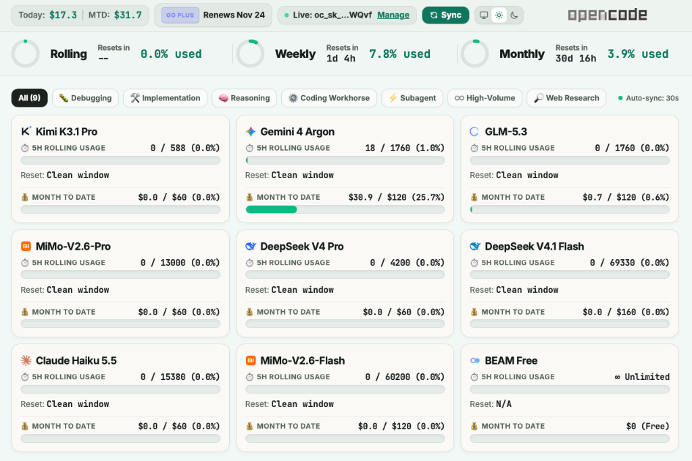

# OpenCode Go Fleet Monitor

A lightweight, real-time HTTP telemetry and quota monitoring dashboard built specifically for **OpenCode Go** ($10/mo) and **OpenCode Go Plus** ($40/mo) subscription plans.

Tracks 5-hour rolling request quotas, monthly dollar allowances, live spend meters, and automatic escalation pathways with zero external dependencies.



---

## 🌐 Quick Start

### 1. Launching the Dashboard
The server runs on port `7890`:
👉 **[http://localhost:7890](http://localhost:7890)**

```bash
# Start manually:
./start.sh

# Stop:
./stop.sh
```

### 2. "Set Up and Forget Forever" (macOS Autostart)
To automatically start and monitor the server as a background service via `launchd`:
```bash
# Install and activate autostart:
./setup_autostart.sh

# Uninstall autostart:
./remove_autostart.sh
```

### 3. macOS Menu Bar Widget (SwiftBar)
To display live usage metrics in the macOS menu bar:
```bash
brew install swiftbar
cp opencode_v6_monitor.5s.py ~/Library/Application\ Support/SwiftBar/plugins/
```

---

## 🚀 Key Features & Capabilities

### 1. Complete Model Fleet Coverage (9 Models)
Accurately configured for both **OpenCode Go** and **OpenCode Go Plus** tiers:
* 🧠 **Kimi K3.1 Pro** (`kimi-k3-1-pro` / Moonshot AI) — 588 req/5h, $60 cap (Go Plus) | 147 req/5h, $15 cap (Go)
* 🐛 **Gemini 4 Argon** (`gemini-4-argon` / Google) — 1,760 req/5h, $120 cap (Go Plus) | 440 req/5h, $30 cap (Go) — *Non-contributing, zero retention*
* 🧠/🛠️ **GLM-5.3** (`glm-5-3` / Zhipu AI) — 1,760 req/5h, $120 cap (Go Plus) | 220 req/5h, $15 cap (Go)
* ⚙️ **MiMo-V2.6-Pro** (`mimo-v2-6-pro` / Xiaomi) — 13,000 req/5h, $60 cap (Go Plus) | 3,250 req/5h, $15 cap (Go)
* 🛠️ **DeepSeek V4 Pro** (`deepseek-v4-pro` / DeepSeek) — 4,200 req/5h, $60 cap (Go Plus) | 1,050 req/5h, $15 cap (Go)
* ♾️ **DeepSeek V4.1 Flash** (`deepseek-v4-1-flash` / DeepSeek) — 69,330 req/5h, $160 cap (Go Plus) | 34,670 req/5h, $80 cap (Go)
* ⚡ **Claude Haiku 5.5** (`claude-haiku-5-5` / Anthropic) — 15,380 req/5h, $60 cap (Go Plus) | 3,850 req/5h, $15 cap (Go)
* ♾️ **MiMo-V2.6-Flash** (`mimo-v2-6-flash` / Xiaomi) — 60,200 req/5h, $120 cap (Go Plus) | 30,100 req/5h, $60 cap (Go)
* 🔎 **BEAM Free** (`beam-free` / Reflection AI) — Unlimited prompts (∞), $0 allowance (Free tier)

### 2. Dual Progress Tracking Per Card
* **5h Rolling Window:** Tracks prompt and request volume within a sliding 5-hour window against the 20% burst limit, with dynamic reset countdowns (`Reset: Clean window` or `in ~Xh Ym`).
* **Monthly Spend Allowance:** Shows month-to-date dollar spend and percentage (`$0.0 / $60 (0.0%)`). Free models display `$0 (Free)`.
* **Clean Formatting:** All numbers (dollars and percentages) are strictly rounded to 1 decimal place (`$17.3`, `7.8%`), while allowance limits are shown as clean integers (`$60`, `$120`).

### 3. Subscription Meters Bar (Row 2)
* **3-Column Grid:** Aligned directly with the model cards below, with vertical dividers in the column gaps.
* **SVG Pie Charts:** Visual progress rings for **Rolling (5h)**, **Weekly**, and **Monthly** spend.
* **Stacked Resets Countdown:** `Resets in` label stacked directly above the countdown value (`1d 5h`, `30d 17h`, `--`).

### 4. Dual Visual Themes
* **Day Mode (Codex Warm Daylight):**
  - Page Background: `#f2f8f5` (warm, natural sage-tinted paper canvas)
  - Top Header: `#edf3f0` with `#d8e0db` border
  - Go Meters Bar: `#f0f6f3` with `#dbe3de` circle tracks and `#ccd5cf` dividers
  - Model Cards: `#faf9f6` (warm ivory surface with `#d6dfd8` borders and soft warm shadows)
  - Accent Color: `#0f765e` (Codex forest emerald)
  - Primary Text: `#151c17` / `#1c221e` (deep obsidian charcoal)
* **Night Mode (JetBrains / PyCharm):**
  - Page Background: `#191a1c`
  - Cards: `#25292c` with `#32363a` borders
  - High-contrast neon glows for Warning and Critical alerts.
* Instant 3-way toggle: `System`, `Day`, `Night` with `localStorage` persistence.

### 5. Brand Identity & Provider Logos
* High-fidelity embedded SVGs for every model provider:
  - Moonshot AI (Kimi)
  - Google Gemini
  - Zhipu AI (GLM)
  - Xiaomi MiMo
  - DeepSeek
  - Anthropic (Claude)
  - Reflection AI (BEAM)
* Centered official OpenCode dual-mode brand wordmark in the top right.

### 6. Live OpenCode Console API Synchronization (Option 3)
* **Automatic Background Daemon:** Polls OpenCode Cloud every 30 seconds for live spend, request logs, and tier changes.
* **Tier Auto-Detection:** Automatically discovers whether your subscription is **Go ($10)** or **Go Plus ($40)** and updates model limits on the fly.
* **Zero-Leak Local Security:** API keys are stored locally on the Mac in `.env` (`chmod 600`) and are never relayed to external servers.
* **Interactive Modals:** In-browser modal for API key entry, validation, and deletion, plus a manual override modal for offline testing.

### 7. Viewport & Hardware Optimization
* Tailored for **10.5" displays (1280 × 854)**.
* Safari Web App standalone mode: 100% full viewport fill rate, scroll-free dashboard layout.

---

## 🏗️ Architecture & Technical Reference

```
opencode_monitor/
├── server.py                   # Self-contained backend & single-page dashboard
├── com.opencode.v6monitor.plist # macOS launchd service definition
├── opencode_v6_monitor.5s.py   # SwiftBar menu bar plugin
├── setup_autostart.sh          # launchd service installer
├── remove_autostart.sh         # launchd service uninstaller
├── start.sh                    # Manual startup script
├── stop.sh                     # Manual shutdown script
├── .env.example                # Environment variable template
└── README.md                   # Project documentation
```

### Dependencies
* **Backend:** Python 3 standard library only (`http.server`, `urllib.request`, `threading`, `json`, `os`, `re`, `datetime`). No `pip install` required.
* **Frontend:** Single-page application served directly by `server.py`, utilizing Tailwind CSS CDN (v3) with class-based dark mode and custom CSS variables.

### HTTP REST API Endpoints

| Method | Endpoint | Description |
| :--- | :--- | :--- |
| `GET` | `/` | Serves the standalone HTML/JS/CSS dashboard |
| `GET` | `/api/status` | Returns complete JSON state (models, alerts, go_status, cost_summary, sync_state) |
| `POST` | `/api/key` | Stores or deletes the OpenCode Console API key in `.env` |
| `POST` | `/api/key/status` | Returns key existence and masked token (`oc_sk_...`) |
| `POST` | `/api/sync` | Triggers immediate cloud synchronization |
| `POST` | `/api/tier` | Sets tier mode (`auto`, `go`, or `go-plus`) |
| `POST` | `/api/update` | Manually updates a model's 5h request count or spend |
| `POST` | `/api/record` | Simulates request usage on a model |

---

## 🔗 OpenCode Cloud Developer Knowledge Base

For future developers (human or AI) extending or debugging this monitor:

* **OpenCode Go Package Details:**
  [https://opencode.ai/go](https://opencode.ai/go)
  *Official tiers comparison, limits, and pricing.*

* **OpenCode Console:**
  [https://opencode.ai/console](https://opencode.ai/console)
  *Generate service account API keys (`oc_sk_...`) under Organization Settings > Keys. Permissions needed: All or Console/Logs.*

* **Cloud Organization ID Configuration:**
  *Configure your organization ID in your local `.env` file as `OPENCODE_ORG_ID=your_org_id`.*

* **Internal Cloud TRPC Endpoints:**
  - Organization limits & subscriptions: `https://opencode.ai/api/trpc/organizations.get...`
  - Usage & daily spend: `https://opencode.ai/api/trpc/billing.getUsage...`

---

## 🔒 Security & Privacy Notice
* `.env`, `monitor_state.json`, and `*.log` files are strictly excluded from version control via `.gitignore`.
* Never commit real `oc_sk_...` tokens or raw usage database files to Git.

---

## 👤 Author
* **Citizenyolo** (GitHub: [Citizenyolo](https://github.com/Citizenyolo))
